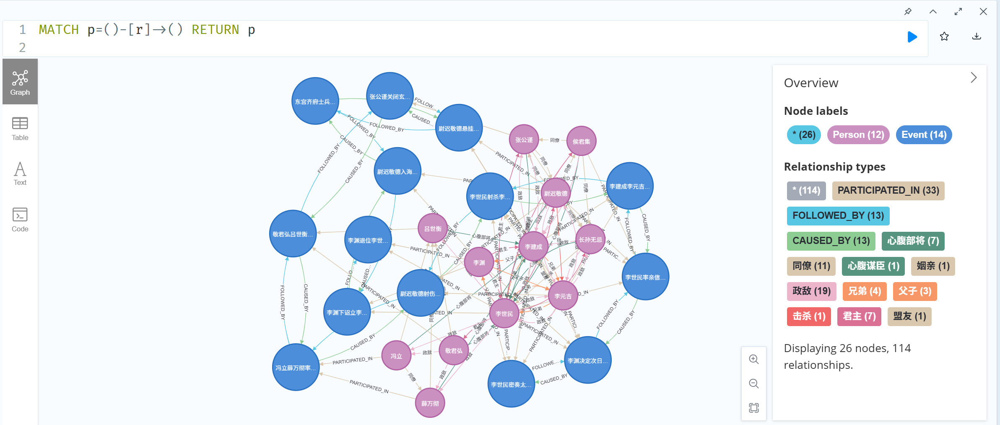
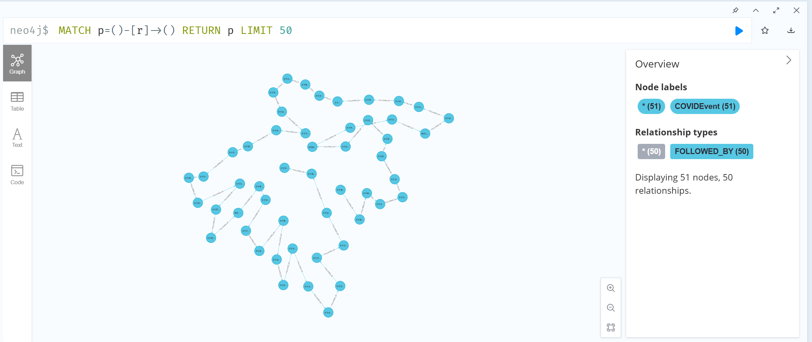
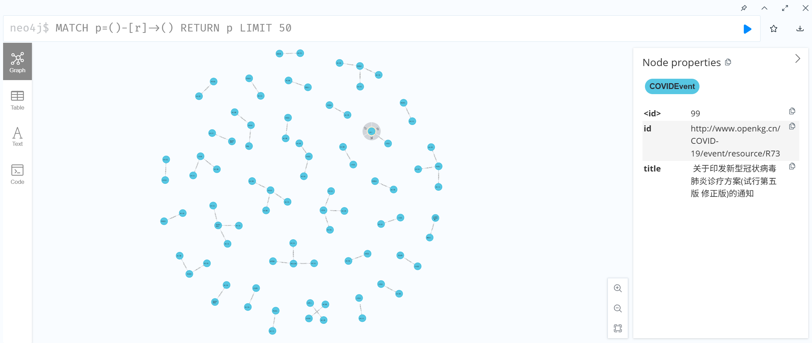
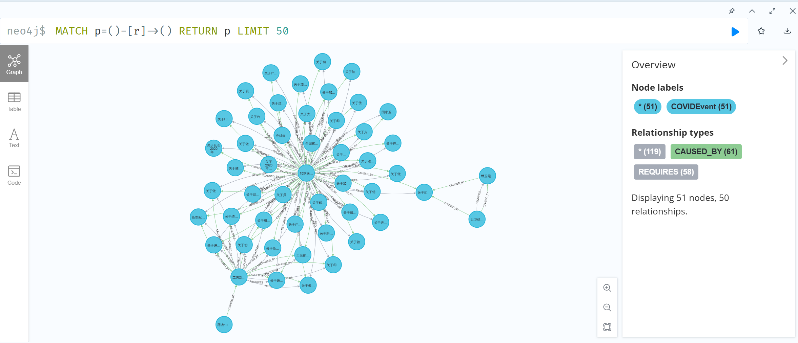
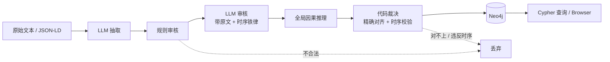

# Event-Knowledge-Graph-Demo

> 用 **DeepSeek + LangChain + Neo4j** 把一段历史文本、或一份 OpenKG 事件数据，变成可查询的事件知识图谱。
>
> 这个仓库不只展示“能跑通”，也保留了两次真实的翻车：因果方向写反、长短 ID 对不上、
> `SequenceMatcher` 把“李世民登基”连成辐射中心。最终结论并不炫酷：
> **在大规模、无因果标注的数据上，宁可只保留可验证的时序边，也不注入一条编造的因果边。**


---

## 目录

- [1. 项目是什么](#1-项目是什么)
- [2. 效果展示](#2-效果展示)
- [3. 核心设计](#3-核心设计)
- [4. 版本演进](#4-版本演进)
- [5. 实验结果（可核对）](#5-实验结果可核对)
- [6. 踩坑记录（Lessons Learned）](#6-踩坑记录lessons-learned)
- [7. 快速开始](#7-快速开始)
- [8. Cypher 查询手册](#8-cypher-查询手册)
- [9. 目录结构](#9-目录结构)
- [10. 数据说明](#10-数据说明)
- [11. 已知局限](#11-已知局限)
- [12. Roadmap](#12-roadmap)
- [13. FAQ](#13-faq)
- [14. 安全与伦理](#14-安全与伦理)
- [15. 致谢](#15-致谢)
- [16. License](#16-license)

---

## 1. 项目是什么

这是一个**事件知识图谱构建的教学/实践仓库**。它回答两个问题：

1. **完整链路是什么？**
   原始文本 → LLM 抽取 → JSON 结构化 → 规则/LLM 审核 → Neo4j 入库 → Cypher 查询/可视化。

2. **LLM 的能力边界在哪？**
   用两个规模的数据做对照：

   | 数据集 | 规模 | 特点 |
   |---|---|---|
   | 玄武门之变 | 约 600 字，14–18 个事件 | 小样本，可用 Prompt 铁律 + 代码审核压住幻觉 |
   | OpenKG 新冠事件 | 195 个事件（55 新闻 + 140 政策） | 大规模真实数据，无因果标注，LLM 因果推理必然退化 |

项目包含四个 Notebook：

- **V1**：只抽事件、时间、参与者，建 `FOLLOWED_BY` + `PARTICIPATED_IN`；
- **V2**：加入 `cause`，用 `SequenceMatcher` 做因果对齐——**故意保留的翻车版**；
- **V3**：双重审核 + 全局常识推理 + 人物关系推理，**主成果**；
- **COVID**：解析 OpenKG JSON-LD，按 `P5` / `P16` 建纯时序网络，**不使用 LLM 补因果**。

### 1.1 它解决什么问题

- 把非结构化叙事转成**可查询**的节点-关系网络；
- 把“事件顺序”“人物参与”“因果关系”分开建模，而不是混成一张模糊的图；
- 给每条边标注**来源与可信度**，让“哪些能信、哪些只是假设”在数据层可见；
- 用真实翻车案例说明：为什么“让大模型直接连边”在工程上不可靠。

### 1.2 它不是什么

- **不是**通用知识图谱平台：schema 是为“事件”手工设计的；
- **不是** GraphRAG / KBQA 系统：仓库只做“建图”，不做问答；
- **不是**生产级系统：没有实体链接、事件共指、人工标注评估、并发/重试/监控；
- **不是**“全自动真理机”：V3 的因果边仍然需要人工复核。

---

## 2. 效果展示

### 2.1 玄武门 V3：事件 + 人物 + 因果



- 26 个节点、114 条关系；
- 14 个事件、12 个人物；
- 事件子图：13 条 `FOLLOWED_BY` + 13 条 `CAUSED_BY`；
- 人物子图：55 条人物关系（父子、兄弟、政敌、心腹部将、同僚、君主等）。

### 2.2 新冠 V1：只有时序，没有因果



> 图中显示 `51 nodes, 50 relationships`，是因为查询带了 `LIMIT 50`。
> **全量数据是 195 个节点、194 条 `FOLLOWED_BY`**，且为单连通分量。
> 这一点很容易被截图误读，已在 [screenshots/README.md](screenshots/README.md) 中注明。

### 2.3 两次失败现场

<details>
<summary><b>新冠 V2：节点碎成孤立小段（点击展开）</b></summary>



V2 让 LLM 对前 60 个事件一次性输出因果、条件、分类。结果是：

- 因果方向写反；
- 时间倒置；
- 分类 key 用完整 URL，代码用短 ID 匹配，全部落空；
- 图上只剩碎片化的时序段。

</details>

<details>
<summary><b>新冠 V3：方向修对了，幻觉没修掉（点击展开）</b></summary>



V3 修正了因果方向、兼容了长短 ID、注入了分类属性，但：

- `15家医` 这类高频实体成为放射中心；
- 61 条 `CAUSED_BY`、58 条 `REQUIRES` 中大量是模板化错配；
- 1 月的“延长假期”被 2 月的“方舱医院”导致。

**方向修对了，不代表语义修对了。**

</details>

---

## 3. 核心设计

### 3.1 端到端流水线



### 3.2 三种关系，三种可信度

这是整个项目最重要的设计。**不要把不同可信度的边混在一起，还都叫“事实”。**

| 关系 | 来源 | 可信度 | 是否默认写入 |
|---|---|---|---|
| `FOLLOWED_BY` | 文本顺序 / OpenKG `P5`、`P16` | **确定性**（可回溯到来源） | 是 |
| `PARTICIPATED_IN` | LLM 抽取的人名 | **较高**（可回原文抽检） | 是 |
| `CAUSED_BY` | LLM 审核 + 全局推理 | **假设**（未经人工标注验证） | V3 写入，但标记 `source='llm_inferred'`；COVID 不写 |
| 人物关系（`政敌` / `心腹部将` 等） | LLM 常识推理 | **假设** | V3 写入，但标记 `source='llm_inferred'` |

因此，项目里有一条“来源审计”Cypher：

```cypher
MATCH ()-[r:CAUSED_BY]->()
RETURN r.source, count(*) AS cnt;
```

你可以一条语句删掉所有推理边，只保留确定性关系：

```cypher
MATCH ()-[r:CAUSED_BY]->()
WHERE r.source = 'llm_inferred'
DELETE r;
```

### 3.3 双重审核：规则 + LLM，各自只做擅长的事

**第一层：代码规则审核**

- 事件名不能为空；
- 事件短语过长则截断；
- `participants` 必须是数组；
- `cause_text` 不能等于事件本身；
- 无法对齐到事件列表的原因，丢弃。

**第二层：LLM 审核（带原文）**

Prompt 里立下三条铁律：

1. **时序铁律**：原因必须早于结果；
2. **终点禁律**：不能把“李世民登基 / 李渊退位”这类最终结局当成中间事件的原因；
3. **原文验证**：找不到原文依据的原因，改为 `null`。

> 关键点：**只给模型 JSON、不给原文，它只能“顺着说”。**
> 把原文一起回喂，它才有机会发现“这个原因在原文里根本不存在”。

**第三层：代码审计（建图后）**

```cypher
MATCH (cause:Event)-[r:CAUSED_BY]->(effect:Event)
WHERE cause.order >= effect.order
RETURN cause.name, effect.name, r.reason;
```

预期结果必须是 **0 行**。如果不是 0，先不要相信这张图。

### 3.4 全局常识推理：LLM 提议，代码裁决

V3 让模型以“历史学家视角”补出原文没明说的深层因果，但加了两道保险：

1. **逐字引用**：`cause_event` / `effect_event` 必须逐字取自事件列表；
2. **代码对齐**：
   - 先精确匹配（去掉空白后逐字相等）；
   - 精确匹配失败才用 `SequenceMatcher`，阈值 **0.86**；
   - Top-2 分数相同（模棱两可）→ 丢弃；
   - 仍然对不上 → 丢弃；
   - `cause.order >= effect.order` → 丢弃。

这就是“LLM 负责提议，代码负责裁决”。

### 3.5 “宁缺毋滥”到底意味着什么

**我们不宣称“整张图 100% 准确”。** 我们承诺的是：

- **确定性关系**（事件、时间、参与者、OpenKG 声明的先后）必须能回溯到来源；
- **推理关系**（因果、人物）必须带 `source='llm_inferred'`，并且可以被一条 Cypher 全部删掉；
- 对无法对齐、违反时序、低置信的边，**默认丢弃**，而不是“先连上再说”。

一句话：

> **宁可只展示 100% 可追溯的时序线，也不向图谱注入一条无法解释的因果线。**

这里的“100%”限定在**确定性关系子集**，不是整张图。V3 的因果边是“可审查的假设”，不是“事实”。

---

## 4. 版本演进

| 版本 | 输入 | 抽取字段 | 关系 | 目的 | 结果 |
|---|---|---|---|---|---|
| **V1** | 玄武门文本 | `event` / `time` / `location` / `participants` | `FOLLOWED_BY`、`PARTICIPATED_IN` | 跑通链路 | 成功，但图谱单调 |
| **V2** | 玄武门文本 | 增加 `cause` / `parent` | 增加 `CAUSED_BY`、`HAS_SUBEVENT` | 加入因果 | **翻车**：结局被当成原因 |
| **V3** | 玄武门文本 | 增加 `cause_text` / `condition_text` / `parent_text` | 因果 + 人物关系 | 压住幻觉 | 主成果，但仍需人工复核 |
| **COVID** | OpenKG JSON-LD | `P1` / `P6` 等 | 仅 `FOLLOWED_BY` | 大规模真实数据 | 纯时序，零 LLM 因果 |

### V1：先让链路跑通

- 只抽“事件、时间、地点、参与者”；
- 事件 ID 由代码生成（`xuanwu_v1_00`），不依赖模型返回字符串；
- 按原文顺序连接 `FOLLOWED_BY`；
- 人物挂 `PARTICIPATED_IN`。

**局限**：单线程时间线，没有因果，没有人物之间的关系。它的价值是“通”，不是“对”。

### V2：`SequenceMatcher` 的经典翻车

- 让模型多输出 `cause`；
- 用字符级 `SequenceMatcher` 把 `cause` 对齐到已有事件；
- 阈值 0.30，超过就连 `CAUSED_BY`。

**为什么翻车**：

- `cause` 经常是一整句话，事件是短句，字面相似度不可靠；
- “李世民”是高频词，会把分数整体抬高；
- 模型把“李世民登基”当成很多事件的原因；
- 阈值 0.30 几乎等于“沾边就连”。

**结果**：最终事件成为辐射中心，时间与因果同时错乱。

### V3：双重审核 + 全局推理

- 第一遍强推理抽取；
- 代码规则审核；
- LLM 带原文审核（时序铁律 / 终点禁律 / 原文验证）；
- 全局因果推理；
- 代码精确对齐 + 时序校验；
- 人物关系推理（类型白名单）；
- 写入因果线，删除同方向冗余 `FOLLOWED_BY`。

### COVID：承认数据边界

- 解析 `P1`（新闻）/ `P6`（政策）；
- 按 `P5` / `P16` 建 `FOLLOWED_BY`；
- 不做 LLM 因果推理；
- 用字段语义定向，暴露 2 条时间倒置；
- 提供 `STRICT_TIME_ORDER` 开关。

---

## 5. 实验结果（可核对）

> 下面的数字来自原组会 PPT、Notebook 运行输出，以及本仓库对 JSON 的重新统计。
> LLM 输出会随模型版本、温度、Prompt 变化，**这些是“参考运行”，不是可复现的基准分数**。

### 5.1 玄武门

| 指标 | 数值 | 口径 |
|---|---|---|
| 文本长度 | 约 600 字 | `data/xuanwumen_text.txt` |
| V1 抽取事件 | 17 | Notebook 示例运行 |
| V2 清洗后事件 | 18 | Notebook 示例运行 |
| V3 抽取事件 | 14 | Notebook 示例运行 |
| V3 人物 | 12 | 原组会 PPT |
| V3 节点 | 26 | 14 事件 + 12 人物 |
| V3 关系 | 114 | 33 `PARTICIPATED_IN` + 13 `FOLLOWED_BY` + 13 `CAUSED_BY` + 55 人物关系 |
| V3 人物关系 | 55 条 | 关系类型由模型输出，约 10 类 |

### 5.2 新冠

| 指标 | 数值 | 口径 |
|---|---|---|
| 事件总数 | **195** | 本仓库脚本解析 JSON |
| 新闻事件 | 55 | `P1` |
| 政策事件 | 140 | `P6` |
| 带 `P5`/`P16` 指针 | 194 | 1 个根节点无前序 |
| 指针可解析 | 194 | 完整 URI / 短 ID 均可解析 |
| 按字段语义定向后时间倒置 | **2 / 194** | 1 条 `P5` 同天逆序 + 1 条 `P16` 跨类 |
| 缺时间 | 0 | 全部指针都有可解析时间 |
| 严格模式边数 | **192** | `STRICT_TIME_ORDER=true` |
| 连通分量 | 1 | 并查集 |
| 截图展示子图 | 51 节点 / 50 边 | `LIMIT 50`，**不是全量** |

> 原始实现把 **139 条 `P16` 全部反向**：20 条跨天 + 119 条同日（时间戳看不出）。
> 再加上 1 条 `P5` 同天逆序、1 条 `P16` 跨类，最终 **22 条边**在时间上倒置。
> 本仓库按字段语义修正后，只剩 2 条时间倒置：
> 1 条 `P5` 同天逆序，1 条 `P16` 跨类指向 1 月的新闻。

### 5.3 一个必须说清楚的数字差异

原组会 PPT 把新冠事件数记为 **194**，本仓库按 JSON 实际解析为 **195**（55 + 140）。
差异来自统计口径（是否把某条边界记录算入）。本仓库不强行把两者改成一个数字，而是：

- 代码以实际解析结果为准；
- README 同时注明两个口径；
- 所有可复现的统计逻辑都在 `4_COVID_Demo_Timeline.ipynb` 里。

同样，PPT/截图里的 **51 节点 / 50 关系**是 `LIMIT 50` 的展示子图，
**全量是 195 节点 / 194 边**。这一点在原复盘里没有写清，容易被误读。

### 5.4 建图代码冒烟测试（不调用 LLM）

为了确认“Cypher 能跑、计数对得上、方向不变式成立”，本仓库在本地 Neo4j 里做了一组
**事务级冒烟测试**：建图后立即查询，再 `rollback()`，不留下测试数据。

| Notebook | 输入 | 结果 | 结论 |
|---|---|---|---|
| V1 | 17 个合成事件 | 22 节点 / 50 关系（16 `FOLLOWED_BY` + 34 `PARTICIPATED_IN`） | Cypher 正常 |
| V2 | 18 个合成事件 | 23 节点 / 53 关系（18 `CAUSED_BY` + 17 `FOLLOWED_BY` + 18 `PARTICIPATED_IN`） | 能复现“乱连”，符合反面教材预期 |
| V3 | 14 事件 / 12 人物 / 33 参与 / 13 因果 / 55 人物关系 | **26 节点 / 114 关系**（33 + 13 + 13 + 55） | 计数与参考截图一致，方向违规 0 |
| COVID | 真实 JSON（195 事件） | **195 节点 / 194 关系** | 全量计数正确 |

> 这组测试验证的是**建图代码**，不是 LLM 输出质量。
> V3 的 14/12/33/13/55 是合成输入，用来复算 26/114 的结构；
> 真实 LLM 运行的数量会随模型版本和 Prompt 变化。

---

## 6. 踩坑记录（Lessons Learned）

### 6.1 因果方向倒置：同一个 `CAUSED_BY`，两种箭头

**现象**

- COVID V2 写成 `(结果)-[:CAUSED_BY]->(原因)`；
- COVID V3 改成 `(原因)-[:CAUSED_BY]->(结果)`；
- 同一个关系类型，前后方向相反，Neo4j Browser 的箭头看起来“都能解释”。

**根因**

把 `CAUSED_BY` 当成中文“因为”来读，而不是英文“caused by”的被动结构；
再加上复制粘贴，方向就反了。

**修复**

统一为：

```cypher
(原因)-[:CAUSED_BY]->(结果)
```

并加入建图后审计：

```cypher
MATCH (cause:Event)-[r:CAUSED_BY]->(effect:Event)
WHERE cause.order >= effect.order
RETURN cause.name, effect.name;
```

预期 0 行。**方向不是注释问题，是数据问题。**

---

### 6.2 长短 ID 对不上：`CONTAINS 'R1'` 会匹配到 `R10`

**现象**

- LLM 返回 `R53`，图里存的是完整 URI；
- 用 `WHERE cause.id CONTAINS $c_id` 匹配，`R1` 会同时命中 `R1`、`R10`–`R19`、`R100`…；
- 分类字典的 key 是完整 URL，代码用短 ID 去查，全部落空，节点没有颜色。

**根因**

把“字符串包含”当成了“身份相等”。

**修复**

- 在 Python 层建立 `full_id <-> short_id` 映射；
- 对齐时用**精确 ID**，不用 `CONTAINS`；
- 如果必须在 Cypher 里匹配，先规范化 ID，再 `WHERE cause.id = $id`；
- 分类 key 同时兼容长短 ID，并在写入前做一次 `dict.get()` 兜底。

```python
def short_id(uri: str) -> str:
    return uri.rstrip("/").split("/")[-1]
```

---

### 6.3 `SequenceMatcher` 被高频词劫持

**现象**

所有事件都被连向“李世民登基”或“李渊退位”，形成放射状假因果。

**根因**

- 字符级相似度对高频人名/地名极敏感；
- `cause` 是长句，事件是短句，长度差异让分数分布很怪；
- 阈值 0.30 太低；
- 原始代码里 `other` 变量在循环结束后仍指向最后一个事件，日志打印的名字可能和真正写入的 `best_match_id` 不一致。

**修复**

- 精确匹配优先；
- 模糊匹配阈值提高到 0.86；
- Top-2 分数相同 → 丢弃；
- 终点禁律：最终事件不能作为原因；
- 时序校验：`cause.order < effect.order`；
- 所有被丢弃的候选都打印原因，方便复盘。

---

### 6.4 数据碎片化：51 个节点不是“全图”

**现象**

新冠截图看起来只有 51 个节点、50 条边，像是碎成很多小段。

**根因**

查询是 `MATCH p=()-[r]->() RETURN p LIMIT 50`。
`LIMIT 50` 限制的是**路径数**，不是节点数；Neo4j Browser 会把路径上的节点都渲染出来，
所以显示 51 个节点、50 条边。

**修复**

- 在 README 和 `screenshots/README.md` 里明确标注“展示子图”；
- 统计全量时用 `MATCH (e:COVIDEvent) RETURN count(e)`，不要看截图右下角；
- 连通分量用并查集单独算：全量是 **1 个分量**，不是碎片。

---

### 6.5 `P5` / `P16` 的方向：时间戳看不出“同日反向”

**现象**

原始实现把 `P5` / `P16` 都当成“前序指针”，统一写成 `target -> current`。
这导致 **139 条 `P16` 全部反向**：

- 20 条 `P16` 跨天，表现为时间倒置；
- 119 条 `P16` 是同一天，箭头方向错了，但时间戳完全相同，**看不出来**。

再加上 1 条 `P5` 同天逆序、1 条 `P16` 跨类指向 1 月新闻，
最终有 **22 条边**在时间上倒置。

**根因**

- `P5` 的标签是“之前发生”，`P16` 的标签是“后续政策”，两者语义相反；
- 代码复用了同一套 `prev -> curr` 写法；
- 同日事件让方向错误在时间戳校验下“隐身”。

**修复**

- `P5`：`target -> current`；
- `P16`：`current -> target`；
- 仍然计算 `r.time_valid`，但不再用时间戳代替语义；
- 修正后只剩 2 条时间倒置（1 条 `P5` 同天逆序 + 1 条 `P16` 跨类）；
- `STRICT_TIME_ORDER=true` 时写入 **192** 条（丢弃这 2 条）。

> 这是本项目最隐蔽的一个坑：**时间戳能抓跨天倒置，但抓不到同日反向。**
> 方向必须由字段语义决定，时间戳只能做二次校验。

---

### 6.6 长上下文下，Prompt 铁律会失效

**现象**

新冠 V2/V3 对 60 个事件做全局推理，仍然出现：

- 1 月的“延长假期”被 2 月的“方舱医院”导致；
- 所有政策套用同一个模板原因；
- `15家医` 成为放射中心。

**根因**

- 事件太多，模型对“每个事件具体是什么”的区分度下降；
- 模型倾向于用高频实体/模板填充因果关系；
- Prompt 里的“必须来自原文”在长上下文里约束力很弱。

**修复**

- 不在无因果标注的大规模数据上强行补因果；
- 如果必须补，先分批、再做检索/候选召回、最后人工复核；
- 把“不写”作为默认选项，而不是“先写了再说”。

---

### 6.7 Notebook 的隐藏状态

**现象**

- 变量在单元格之间泄漏；
- 先跑后面的 cell，再跑前面的 cell，图里出现重复节点；
- `for` 循环结束后 `other` 仍指最后一个元素，日志“骗人”。

**修复**

- 每个 Notebook 都把建图逻辑封装成函数；
- 事件 ID 由代码生成，不用模型字符串；
- 约束 + `MERGE` 保证幂等；
- 清库必须显式 `RESET_DB=true`；
- 建图后跑数量/方向/来源审计。

---

### 6.8 密钥写进 Notebook

**现象**

原始实验 Notebook 里出现过硬编码的 API Key 和 Neo4j 密码。

**修复**

- 本仓库全部改为 `.env` + `python-dotenv`；
- `.gitignore` 忽略 `.env`；
- 代码里不出现任何真实密钥；
- **如果你从旧版本复制过 Notebook，请立刻轮换 API Key 和数据库密码**；
- Git 历史里如果已经提交过密钥，删文件没用，必须轮换并清理历史。

---

## 7. 快速开始

### 7.1 前置条件

| 依赖 | 要求 |
|---|---|
| Python | 3.10 – 3.12（开发时使用 3.12.4） |
| Neo4j | 5.x 或 6.x，Community 版即可 |
| LLM | DeepSeek API Key（OpenAI 兼容接口） |
| Jupyter | Jupyter Lab / Notebook |

### 7.2 克隆与安装

```bash
git clone https://github.com/<your-account>/Event-Knowledge-Graph-Demo.git
cd Event-Knowledge-Graph-Demo
```

Windows PowerShell：

```powershell
python -m venv .venv
.\.venv\Scripts\Activate.ps1
pip install -r requirements.txt
Copy-Item .env.example .env
notepad .env
```

macOS / Linux：

```bash
python3 -m venv .venv
source .venv/bin/activate
pip install -r requirements.txt
cp .env.example .env
${EDITOR:-nano} .env
```

### 7.3 启动 Neo4j

方式一：Docker

```bash
docker run -d \
  --name neo4j-event-kg \
  -p 7474:7474 -p 7687:7687 \
  -e NEO4J_AUTH=neo4j/please-change-me \
  neo4j:5
```

方式二：Neo4j Desktop / 本地安装

- 新建一个本地数据库；
- 记下 Bolt 地址（默认 `bolt://localhost:7687`）、用户名、密码；
- 填入 `.env` 的 `NEO4J_URI` / `NEO4J_USER` / `NEO4J_PASSWORD`。

### 7.4 配置 `.env`

```dotenv
DEEPSEEK_API_KEY=sk-your-key-here
DEEPSEEK_MODEL=deepseek-chat

NEO4J_URI=bolt://localhost:7687
NEO4J_USER=neo4j
NEO4J_PASSWORD=your-neo4j-password

RESET_DB=false
STRICT_TIME_ORDER=false
```

> `.env` 不要提交到 Git。仓库只提交 `.env.example`。
>
> 默认模型名是官方当前的 `deepseek-flash`。如果你的账户/代理仍只支持旧别名
> `deepseek-chat`，把 `DEEPSEEK_MODEL` 改回去即可，其余代码不用动。

### 7.5 运行顺序

```text
notebooks/
├── 1_Xuanwumen_V1_Basic.ipynb          # 先跑这个，确认链路通
├── 2_Xuanwumen_V2_Hallucination.ipynb  # 反面教材，建议单独跑/单独库
├── 3_Xuanwumen_V3_Ultimate.ipynb       # 主成果
└── 4_COVID_Demo_Timeline.ipynb         # 需要先下载 OpenKG JSON
```

启动：

```bash
jupyter lab
```

建议：

1. **V2 会故意写入错误因果**。如果不想污染 V1/V3 的图，跑 V2 前把 `RESET_DB=true`，或换一个 Neo4j database；
2. V3 一次运行会调用 4 次 LLM（抽取、审核、全局因果、人物关系），注意成本；
3. COVID Notebook 不需要 LLM，只需要 Neo4j 和 JSON 文件。

### 7.6 下载新冠数据

本仓库不包含 `event-covid-19-v0.2.json`。请：

1. 打开 [xyjigsaw/COVID19-KBQA-DEMO](https://github.com/xyjigsaw/COVID19-KBQA-DEMO)；
2. 找到 `event-covid-19-v0.2.json`；
3. 放到 `data/event-covid-19-v0.2.json`；
4. 运行 `4_COVID_Demo_Timeline.ipynb`。

详细字段说明见 [data/README.md](data/README.md)。

---

## 8. Cypher 查询手册

### 8.1 玄武门 V3

```cypher
// 全图
MATCH p=()-[r]->() RETURN p LIMIT 100;

// 事件子图
MATCH p=(e1:Event)-[r]->(e2:Event) RETURN p LIMIT 100;

// 人物子图
MATCH p=(p1:Person)-[r]->(p2:Person) RETURN p LIMIT 100;

// 只要因果链
MATCH p=(cause:Event)-[:CAUSED_BY]->(effect:Event) RETURN p;

// 因果方向审计：预期 0 行
MATCH (cause:Event)-[r:CAUSED_BY]->(effect:Event)
WHERE cause.order >= effect.order
RETURN cause.name, effect.name, r.reason;

// 按来源统计
MATCH ()-[r:CAUSED_BY]->()
RETURN r.source, count(*) AS cnt;

// 删除所有 LLM 推理因果，只保留确定性关系
MATCH ()-[r:CAUSED_BY]->()
WHERE r.source = 'llm_inferred'
DELETE r;
```

### 8.2 新冠纯时序

```cypher
// 展示子图（注意 LIMIT 50 不是全量）
MATCH p=(:COVIDEvent)-[:FOLLOWED_BY]->(:COVIDEvent)
RETURN p LIMIT 50;

// 全量节点/边
MATCH (e:COVIDEvent) RETURN count(e);
MATCH (:COVIDEvent)-[r:FOLLOWED_BY]->(:COVIDEvent) RETURN count(r);

// 最近 20 条
MATCH (e:COVIDEvent)
RETURN e.title, e.time
ORDER BY e.timestamp DESC
LIMIT 20;

// 时间校验不通过的边（2 条时间倒置）
MATCH (:COVIDEvent)-[r:FOLLOWED_BY]->(:COVIDEvent)
WHERE r.time_valid = false
RETURN count(r);

// 按来源统计
MATCH (:COVIDEvent)-[r:FOLLOWED_BY]->(:COVIDEvent)
RETURN r.source, count(*) AS cnt;
```

---

## 9. 目录结构

```text
Event-Knowledge-Graph-Demo/
├── README.md
├── requirements.txt
├── .gitignore
├── .env.example
├── LICENSE
├── data/
│   ├── xuanwumen_text.txt          # 随仓库提供
│   └── README.md                   # 新冠数据下载说明（JSON 不入库）
├── notebooks/
│   ├── 1_Xuanwumen_V1_Basic.ipynb
│   ├── 2_Xuanwumen_V2_Hallucination.ipynb
│   ├── 3_Xuanwumen_V3_Ultimate.ipynb
│   └── 4_COVID_Demo_Timeline.ipynb
└── screenshots/
    ├── README.md
    ├── xuanwumen_v3_full.png
    ├── covid_v1_timeline.png
    ├── covid_v2_isolated.png
    └── covid_v3_hallucination.png
```

---

## 10. 数据说明

### 10.1 玄武门文本

- 约 600 字，现代汉语教学摘要；
- **不是**史料逐字原文；
- 仅用于演示抽取、对齐、审核、建图；
- 如需替换，保持 UTF-8 编码，覆盖 `data/xuanwumen_text.txt` 即可。

### 10.2 新冠 JSON-LD

- 来源：OpenKG 新冠事件数据，实践中使用
  [xyjigsaw/COVID19-KBQA-DEMO](https://github.com/xyjigsaw/COVID19-KBQA-DEMO) 转存版本；
- 本仓库**不重新分发**，`.gitignore` 已排除；
- 字段：`P1` 新闻标题、`P6` 政策标题、`P5` 前序指针、`P16` 后续指针、`P0`/`P7` 时间；
- 版权/许可归原始数据方，MIT License 不覆盖该数据。

### 10.3 事件数量口径

| 口径 | 数值 |
|---|---|
| JSON 实际解析 | **195**（55 新闻 + 140 政策） |
| 原组会 PPT | 194 |
| 带前序指针 | 194 |

差异来自统计口径，不强行统一；代码以实际解析为准。

---

## 11. 已知局限

1. **没有实体链接**：同一人物的别名（李世民 / 秦王 / 太宗）不会被合并；
2. **没有事件共指**：同一事件的不同表述会被当成不同节点；
3. **没有人工标注评估**：因果边没有 ground truth，也没有 precision/recall；
4. **没有时间约束求解器**：只做 `cause.order < effect.order` 的粗校验，不处理“同一天内部顺序”；
5. **时间解析有限**：只覆盖 `MM/DD/YYYY, HH:MM:SS`、`YYYY年MM月DD日`、`YYYY-MM-DD`；
6. **人物关系依赖模型常识**：可能与史实有出入；
7. **没有并发/重试/限流**：生产化需要加 tenacity、队列、成本控制；
8. **Neo4j 版本**：使用 5.x 的 `CREATE CONSTRAINT ... IF NOT EXISTS FOR ... REQUIRE` 语法，4.x 需要改写法；
9. **成本**：V3 一次运行 4 次 LLM 调用，长文本/多次重跑会产生费用。

---

## 12. Roadmap

- [ ] 用 Pydantic / JSON Schema 约束模型输出，减少解析失败；
- [ ] 加入实体链接（人物别名表、同义词归一）；
- [ ] 加入事件共指（相似事件合并）；
- [ ] 引入时间约束求解器（Allen's interval algebra 或简单拓扑排序）；
- [ ] 建立人工标注集，评估因果边的 precision / recall；
- [ ] 加入人工审核 UI（接受/拒绝/修改每条推理边）；
- [ ] 批量导入 + 断点续跑 + 成本统计；
- [ ] 可选：GraphRAG / KBQA 问答层（当前仓库不做）。

---

## 13. FAQ

### Q1：为什么不用 `LLMGraphTransformer`？

`LLMGraphTransformer` 适合“通用图谱快速起步”，但本项目需要：

- 固定的事件 schema；
- `cause.order < effect.order` 这种代码级不变式；
- 对每条推理边标注来源、置信度、匹配分数；
- 建图后做方向/来源审计。

通用转换器很难把这些约束全部表达清楚。作者也做过 `LLMGraphTransformer + Neo4j` 的书目图谱实验，
但本仓库聚焦“事件”，因此没有把它作为主路径。

### Q2：为什么新冠不补因果？

因为数据没有因果标注。让通用模型对 195 个事件“凭空推理”，得到的是模板化错配，
不是可验证的知识。**不写，比写错更好。**

### Q3：为什么截图只有 51 个节点？

查询带了 `LIMIT 50`，限制的是路径数。全量是 195 个节点、194 条边，
见 [5.2](#52-新冠) 和 [screenshots/README.md](screenshots/README.md)。

### Q4：V1 有 17 个事件，V3 只有 14 个，哪个对？

都不一定“对”。LLM 输出会随模型版本、温度、Prompt 变化。
V1 的 Prompt 要求 10–20 个事件，V3 要求“核心事件 + 因果字段”，抽取粒度不同。
**数量不是质量指标**；本项目更关注“每条边是否能解释”。

### Q5：能把 DeepSeek 换成 OpenAI / Qwen 吗？

可以改 `ChatDeepSeek` 为对应的 LangChain chat model，但本项目只在 DeepSeek 上验证过。
换模型后，Prompt 的 JSON 遵循度、人物关系类型、因果质量都可能变化，需要重新跑审计。

### Q6：能用于生产吗？

不建议直接用于生产。至少需要补：

- 人工审核流程；
- 评估集与指标；
- 实体链接/事件共指；
- 失败重试、限流、成本控制；
- 数据脱敏与访问控制。

### Q7：为什么 `requirements.txt` 里没有 `difflib`？

`difflib` 是 Python 标准库，不需要也不能通过 pip 安装。
V2 直接 `from difflib import SequenceMatcher` 即可。

---

## 14. 安全与伦理

- **不要提交 `.env`**：API Key、数据库密码只放本地；
- **轮换泄露密钥**：如果你从旧版本复制过 Notebook，请立刻更换 DeepSeek Key 和 Neo4j 密码；
- **不要公网暴露 Neo4j**：Demo 默认只监听本地 `7687/7474`；
- **注意数据合规**：新冠数据来自公开数据集，但再分发前请阅读原始许可；
- **LLM 调用会发送文本**：不要把未公开、涉密、含个人隐私的文本发给第三方 API；
- **不要把推理边当事实**：V3 的因果/人物关系是模型假设，对外展示时应标注来源。

---

## 15. 致谢

- [OpenKG](http://openkg.cn/)：提供新冠事件数据；
- [xyjigsaw/COVID19-KBQA-DEMO](https://github.com/xyjigsaw/COVID19-KBQA-DEMO)：提供 JSON-LD 转存；
- [LangChain](https://github.com/langchain-ai/langchain)：Prompt / Chain / Output Parser；
- [Neo4j](https://neo4j.com/)：图数据库与 Browser 可视化；
- [DeepSeek](https://www.deepseek.com/)：抽取与推理模型；
- 组会讨论中提出的问题，直接推动了 V2 → V3 的审核设计。

---

## 16. License

- **代码与文档**：[MIT](LICENSE)；
- **第三方数据**：不适用 MIT，遵循 OpenKG / 原仓库的许可；
- `data/xuanwumen_text.txt` 为项目自建教学文本，转载/再使用请注明来源。

---

如果这个仓库对你有帮助，欢迎 Star；如果你发现了因果边、时间线或人物关系中的错误，
请带上对应的 Cypher 查询和截图提 Issue——**这比一句“感觉不对”更有用。**
